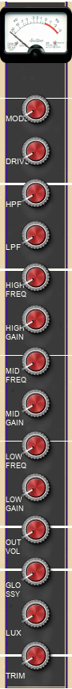

# Chameleon Console

A mono **console channelstrip** audio plugin that changes its *colour* — both
tonally and visually — across **17 classic console eras**. The DSP and the
bitmap GUI are written in **Free Pascal / Lazarus**; the artwork (backgrounds,
knob sprite-strips, VU meters) is data-driven, so the desk can be re-skinned or
re-calibrated without touching code.



- **Formats:** CLAP (native) and VST3 (via clap-wrapper). AUv2 optional.
- **Platforms:** Windows (x64), Linux (x64 / arm), macOS (Intel / Apple Silicon).
- **GUI:** embedded plugin window — Win32 (GDI), Linux (X11), macOS (Cocoa).
- **License:** MIT (see `LICENSE`).

---

## Features

- **17 console eras**, switchable by clicking the era label under the VU:
  Neve 1073, API 500, SSL 4000G, Neve ISA, Mackie VLZ, EMI REDD, UA Classic,
  Telefunken V72, Helios 69, Hybrid, RCA SR-780, Detroit, Studer 169,
  Polar Nordic, Harrison 32C, Trident A-Range, MCI JH Series.
- **Per-era artwork** — each era has its own background, 14 knob sprite-strips
  and a VU strip, so the whole channel changes its look with the era.
- **15 automatable parameters** (see table below), all exposed to the DAW.
- **Sprite-strip knobs & VU** — vertical strips (50×50 knob frames, 90×70 VU
  frames), alpha-blended over the background (round knobs, no black box).
- **Ballistic VU** with per-era calibration via `vu.ini` (`min_db`, `max_db`,
  `frames`).
- **Per-knob taper** via `knobs.ini` (`linear` / `log` / `reverse`) — "tune the
  desk" like an old-school engineer.
- **Clean, side-by-side install** — per-user or system-wide, CLAP and/or VST3,
  with a clean-install option (see below).

---

## Channelstrip parameters

| # | Name | Range | Default |
|---|------|-------|---------|
| 0 | Console (era) | 0–16 | Neve 1073 |
| 1 | Trim | −24 … +24 dB | 0 |
| 2 | Drive | 0 … 100 | 0 |
| 3 | HPF | 0 … 500 Hz | 20 |
| 4 | LPF | 1000 … 20000 Hz | 10000 |
| 5 | EQ Lo Freq | 20 … 500 Hz | 80 |
| 6 | EQ Lo Gain | −15 … +15 dB | 0 |
| 7 | EQ Mid Freq | 80 … 8000 Hz | 1000 |
| 8 | EQ Mid Gain | −15 … +15 dB | 0 |
| 9 | EQ Hi Freq | 500 … 20000 Hz | 5000 |
| 10 | EQ Hi Gain | −15 … +15 dB | 0 |
| 11 | Lux | 0 … 1 | 0 |
| 12 | Gloss | 0 … 1 | 0 |
| 13 | Tape | 0 … 1 | 0 |
| 14 | Volume | −24 … +12 dB | +8 |

The **Console** parameter selects the era; the GUI label under the VU also cycles
it on click.

---

## Installation

The Windows installer offers:

- **Per-user** (no admin) or **system-wide** (admin) — your choice.
- **CLAP**, **VST3**, or **both**.
- **Clean install** (default) or in-place upgrade.

Standard plugin locations used:

| Format | Per-user | System |
|--------|----------|--------|
| CLAP | `%LOCALAPPDATA%\Programs\Common\CLAP\ChameleonConsole\` | `%CommonProgramFiles%\CLAP\ChameleonConsole\` |
| VST3 | `%LOCALAPPDATA%\Programs\Common\VST3\` | `%CommonProgramFiles%\VST3\` |

On Linux/macOS, copy the `.clap` bundle (or the CLAP/VST3 from the release
archive) into your DAW's plugin folder. The artwork must sit next to the plugin
(the installers handle this automatically).

---

## Usage

1. Load **Chameleon Console** on a mono track in your DAW.
2. Click the **era label** (under the VU) to cycle the 17 consoles — the whole
   channel re-skins and the DSP colour changes.
3. Drag a **knob** vertically to change its parameter (automatable).
4. The **VU** shows the output level with the era's calibration.

---

## Customising the desk

All artwork and calibration live in `Assets/<era>/`:

```
Assets/<era>/
  background.png        full channel background (90×852)
  knobs/<function>.png  vertical knob sprite-strip (50×50 frames)
  vu.png                vertical VU sprite-strip (90×70 frames)
  vu.ini                VU calibration: min_db, max_db, frames
  knobs.ini             per-knob taper: linear | log | reverse
```

Knob functions: `trim, drive, hpf, lpf, eq_lo_f, eq_lo_g, eq_mid_f, eq_mid_g,
eq_hi_f, eq_hi_g, lux, gloss, tape, volume`. Replace a strip or edit the `.ini`
files to re-tune the desk — no rebuild required.

---

## Building from source

Requirements: Free Pascal (fpcupdeluxe with the x86_64 / aarch64 / arm
cross-compilers), and for VST3 the clap-wrapper + CLAP/VST3 SDKs under `deps/`.

```bat
:: verify the toolchain
build_all.bat --check

:: build all targets + packages (win64, linux-x64, macos-intel, macos-aarch64)
build_all.bat
```

Artifacts (version-stamped) land in `Deploy/`:

- `ChameleonConsole-<ver>-win64.zip` + `ChameleonConsole-<ver>-win64-setup.exe`
- `ChameleonConsole-<ver>-linux-x64.tar.gz`
- `ChameleonConsole-<ver>-macos-intel.zip`, `...-macos-aarch64.zip`
- `ChameleonConsole-<ver>-win64.vst3`

`NO_VERSION_BUMP=1` builds the current version without rewriting it.

---

## Project structure

```
clap_skeleton.lpr        library entry (exports clap_entry)
clapplugin.pas           CLAP entry/factory/plugin/params/state/gui wiring
ChannelStripDSP.pas      the DSP (17-era channelstrip)
guiwin.pas               embedded GUI: Win32 / X11 / Cocoa
pngload.pas              PNG → HBITMAP (Win32)
hostcb.pas               cdecl callback helpers
clap.pas                 CLAP ABI types
installer/               Inno Setup installer.iss
tools/                   host harness, zip helpers
Assets/<era>/            artwork + ini calibration
docs/                    manual & web docs (EN/DE/ES/FR/PT/RU/ZH)
build_all.bat            multi-target build + packaging
```

---

## Documentation

A full manual and web docs live in [`docs/`](docs/) (English plus DE/ES/FR/PT/RU/ZH).

---

## License

MIT — see [`LICENSE`](LICENSE). Copyright (c) 2026 Martin Haverland.